<div align="center">

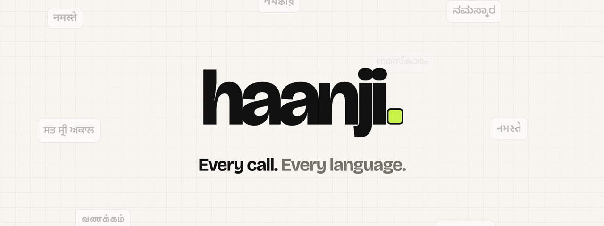

### Your phone, answered in the caller's language.

Haanji picks up when you can't. A Kannada-speaking rider gets guided to your exact gate, a patient gets the clinic's timings, and a fake "Delhi Police" caller gets cut off before reaching your mother.

<br>

[](https://haanji-help.vercel.app)
[](tel:+918047290685)
[](https://gnani.ai)

<sub>Gnani Prisma speech-to-text · Gnani Timbre text-to-speech · reasoning model ready for Gnani Evon · 10 Indian languages · real phone calls</sub>

<br>

[**Judge walkthrough**](#-judge-walkthrough-5-minutes) · [Features](#-what-haanji-does) · [Architecture](#-architecture) · [Gnani models](#-the-gnani-stack) · [Run locally](#-run-it-yourself)

</div>

<br>

## ✦ Why

- **About 450 million Indians live outside their home state.** In Bengaluru, Chennai or Hyderabad, the delivery rider, the auto driver and the hospital desk often speak a language you don't.
- **Riders still call to ask "where are you?"** They lose minutes at every gate, and you're in a meeting, driving, or can't talk.
- **Phone fraud goes after parents.** "Digital arrest", fake KYC and fake customs calls come in their own language, with fear and a ticking clock.

Haanji is one number that answers all of these calls, in the caller's language, with what *you* taught it.

<br>

## ✦ What Haanji does

<table>
<tr>
<td width="33%" valign="top">

#### 🛵 Rider & driver calls
Answers in the caller's language and gives your **exact typed address first**. Then it asks *"where are you, bhaiya?"*, looks the place up on Google Maps and gives turn-by-turn directions with landmarks. If the rider moves, it re-routes.

</td>
<td width="33%" valign="top">

#### 🛡️ Scam Shield for parents
Screens every unknown number on your parent's phone. It spots authority, threat, secrecy and OTP-or-money patterns, ends the call politely and **alerts you right away**.

</td>
<td width="33%" valign="top">

#### 🩺 Receptionist for your work
Clinics, shops and tutors teach it once: timings, credentials, fees and rules. It answers patients and customers and takes messages. **It never gives medical advice.**

</td>
</tr>
<tr>
<td valign="top">

#### 📞 Haanji calls for you
Makes outgoing calls on your behalf: *book a table at 8*, *book an appointment*, *ask if they're open*, or any errand you type. You get the outcome back.

</td>
<td valign="top">

#### 🎧 Join live, or type
Listen in and talk over Haanji at any time; it steps back. Or type, and Haanji speaks your words. Made for deaf and hard-of-hearing users.

</td>
<td valign="top">

#### 🔎 Check a call
Say or paste what a caller said, in any language or mixed, and get a verdict, the reasons, and the **1930** cyber-crime helpline.

</td>
</tr>
</table>

<p align="center">
  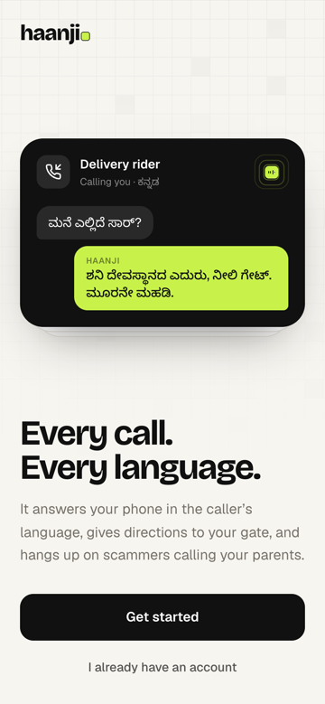
  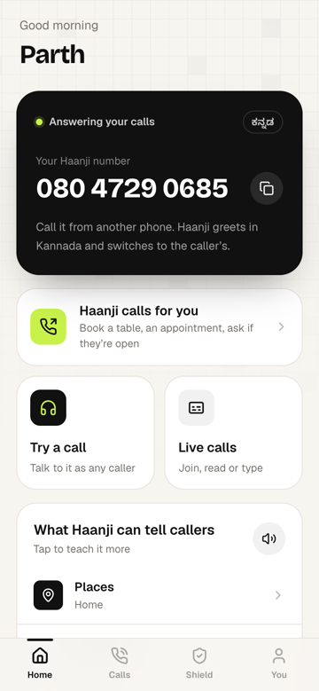
  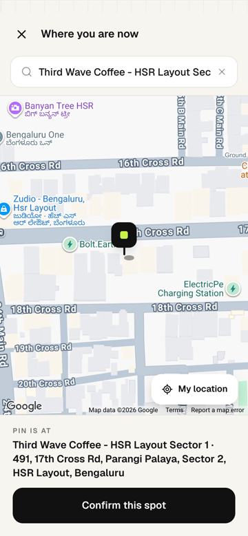
  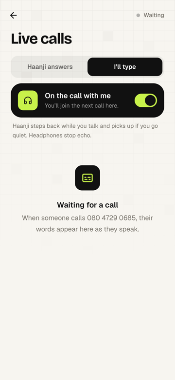
  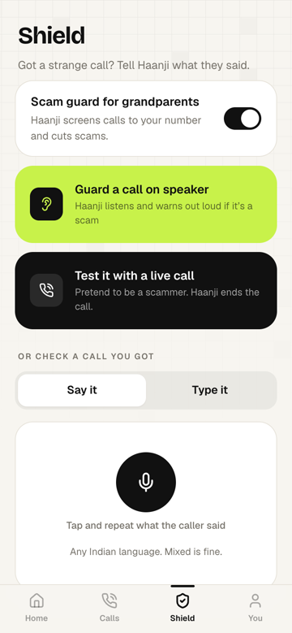
  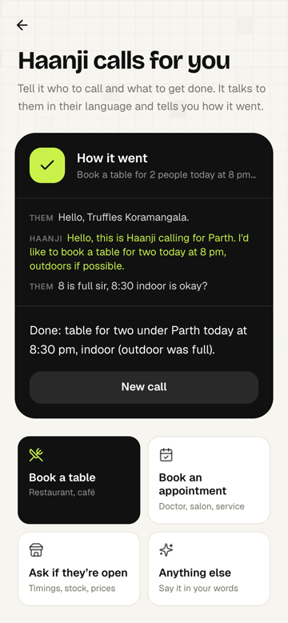
</p>

<br>

## ✦ Judge walkthrough (5 minutes)

> [!IMPORTANT]
> **The shared number belongs to whoever signed up or signed in most recently.** When you finish setup, or sign in again later, **080 4729 0685 starts answering as *your* Haanji**: your name, your address, your language and your rules. Nobody else's. If someone signs in after you, tap **"Answer 080 4729 0685 for me"** on Home to take it back.

| # | Do this | What you'll see |
|:-:|---|---|
| **1** | Open **[haanji-help.vercel.app](https://haanji-help.vercel.app)** and sign up with your mobile number (6-digit OTP). | A phone-first app in paper, ink and lime. |
| **2** | Pick your language and what Haanji is for (deliveries, work, family). Finish setup. | Home shows **"Answering your calls"** next to 080 4729 0685. |
| **3** | **Teach → Places → Home:** pin your gate on the map and type your exact address. Add a landmark or two. | Haanji will say the typed address first, word for word. |
| **4** | From any phone, **call 080 4729 0685** and pretend to be a lost rider: *"Bhaiya, Swiggy se hoon, main Agara Lake signal pe hoon, kaise aaun?"* Try Kannada, Tamil or Hindi. | It answers in your language, says *"one moment, checking the map"*, then gives distance and turns with landmarks. |
| **5** | Turn on **Shield → Scam guard for grandparents**, call again and play a scammer: *"Main Delhi Police cyber cell se bol raha hoon… digital arrest… call mat kaatna."* | Haanji ends the call politely and you get a scam alert. |
| **6** | Open **Calls → Live calls** and switch on *On the call with me*, then call the number. | Live captions; talk over Haanji and it goes quiet. Or type, and Haanji speaks your words. |
| **7** | **Home → Haanji calls for you:** *Book a table for 2 at 8 pm.* | Status goes dialing → on call → done, with a summary of the outcome. |

> [!NOTE]
> The phone line runs on an Exotel trial account, so **outgoing** errand calls can only reach numbers verified on that account. Incoming calls to 080 4729 0685 work from any phone. No phone handy? Use **Try a practice call** in the app: it runs the same live pipeline in your browser.

<br>

## ✦ Architecture

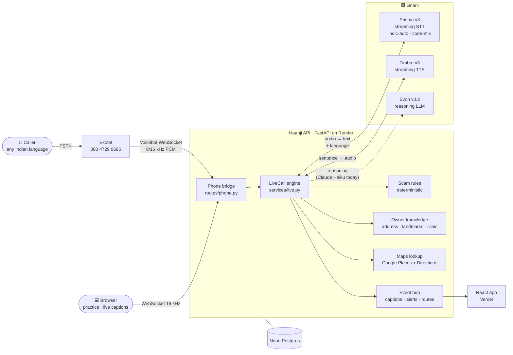

### One turn of a live call

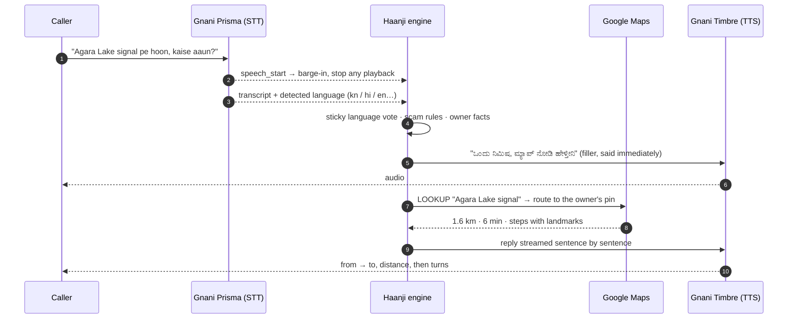

**Design choices that matter on a real phone line**

- **Barge-in.** Prisma's `speech_start` cuts Haanji off mid-word. The browser checks its own mic level first, so Haanji's echo can't interrupt itself.
- **Sentence streaming.** The reply is cut at sentence boundaries and each sentence goes to Timbre as soon as it's complete, so the first word plays in well under a second.
- **No dead air.** While the map lookup runs in the background, Haanji says a natural filler line in the caller's language.
- **Sticky language.** A call stays in the language it started in. A few English words don't switch it; it changes only after two longer utterances in the new language.
- **Scam verdicts are rules first.** Deterministic signals work across English, Hinglish and Devanagari. The model can raise a verdict but never lower it.
- **One engine, every transport.** `LiveCall` doesn't care whether audio comes from Exotel, Twilio or a browser tab.

<br>

## ✦ The Gnani stack

| | Model | What Haanji uses it for |
|---|---|---|
| 🎙️ | **[Gnani Prisma v3](https://gnani.ai)** | Streaming speech-to-text with `indic-auto` language detection and code-mix, so "Swiggy ki delivery hai, exactly kidhar aana hai?" comes through as said. Voice-activity events drive barge-in. |
| 🔊 | **[Gnani Timbre v3](https://gnani.ai)** | Streaming text-to-speech. Four voices (Shivani, Avinash, Riyaa, Devansh) that speak all 10 languages, one sentence at a time. |
| 🧠 | **[Gnani Evon v3.3](https://huggingface.co/gnani/gnani-evon-v3.3-30B-A3B)** | Gnani's open reasoning model (30B MoE, about 3B active). The call brain is built around a generic chat interface, so **Evon can run Haanji's reasoning as a drop-in**: set one env var. The hosted demo uses Claude Haiku 5.5 for now, because Evon needs its own 80 GB GPU. |

**Switching the brain to Evon**

```bash
# on a GPU box (80 GB)
vllm serve gnani/gnani-evon-v3.3-30B-A3B --served-model-name model --trust-remote-code \
  --enable-auto-tool-choice --tool-call-parser qwen3_coder --reasoning-parser nano_v3

# on the Haanji API
LLM_BASE_URL=https://<gpu-host>/v1   # Evon takes over automatically (api/app/services/llm.py)
```

**Languages:** हिन्दी · English · ಕನ್ನಡ · தமிழ் · తెలుగు · മലയാളം · मराठी · বাংলা · ગુજરાતી · ਪੰਜਾਬੀ

<br>

## ✦ From the demo film

<p align="center">
  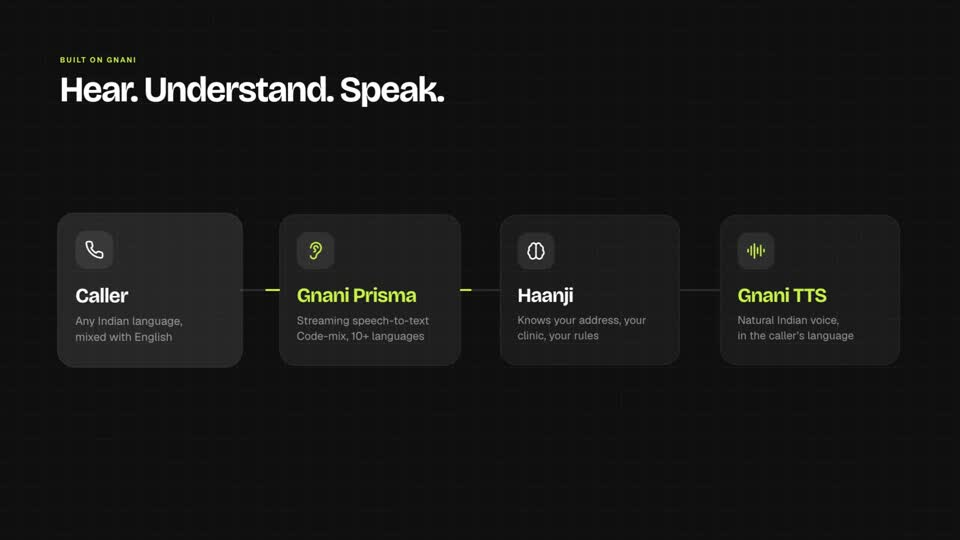
  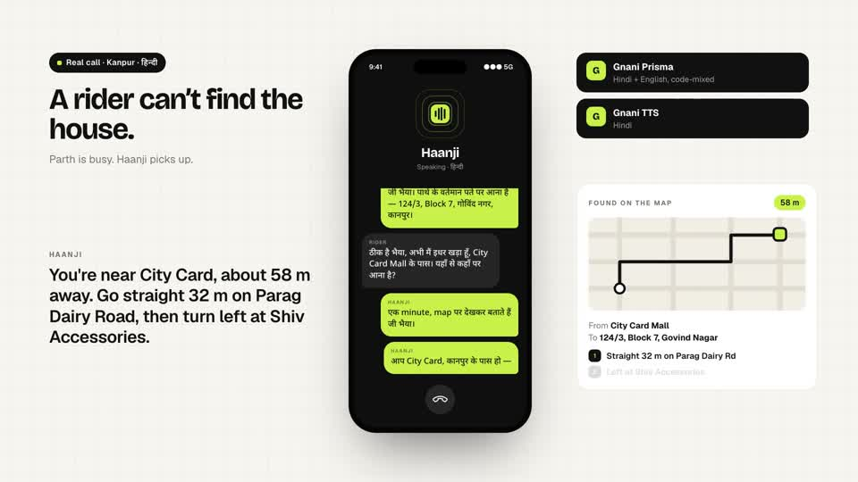
  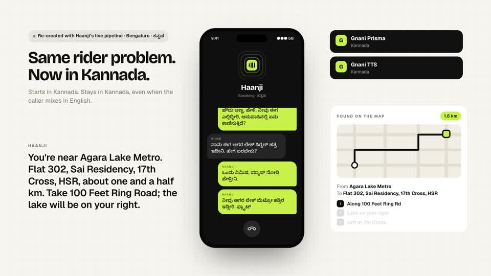
  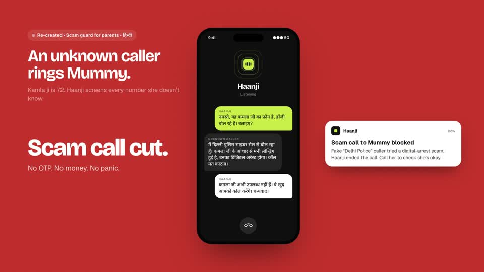
</p>

<br>

## ✦ Repo

```
api/                       FastAPI backend (Render)
├─ app/routes/phone.py       Exotel / Twilio media-stream bridge → LiveCall
├─ app/routes/errands.py     "Haanji calls for you" (outgoing calls)
├─ app/services/live.py      the live call engine: STT ⇄ reasoning ⇄ TTS, barge-in, lookups
├─ app/services/gnani.py     Gnani Prisma + Timbre clients
├─ app/services/llm.py       reasoning backend: Gnani Evon (vLLM) or Claude Haiku
├─ app/services/places.py    Google Places / Directions, landmark-style steps
├─ app/services/scam_rules.py deterministic scam signals (en / hi / Hinglish)
├─ app/services/ownership.py who the shared number answers for
└─ tests/                    pytest suite
web/                       React + Vite + Tailwind (Vercel), phone-first UI
docs/                      product notes and media
```

<br>

## ✦ Run it yourself

```bash
# backend
cd api && python3.12 -m venv .venv && .venv/bin/pip install -r requirements.txt
cp .env.example .env        # GNANI_API_KEY, ANTHROPIC_API_KEY (or LLM_BASE_URL for Evon), GOOGLE_MAPS_KEY
                            # leave TWOFACTOR_API_KEY empty → test OTP 123456
.venv/bin/uvicorn app.main:app --reload --port 8000
.venv/bin/python -m pytest -q

# frontend
cd web && npm install && npm run dev      # http://localhost:5173
```

**Deploy:** backend on **Render** (`render.yaml`, root `api/`, Neon Postgres via `DATABASE_URL`) · frontend on **Vercel** (root `web/`, `VITE_API_URL=https://<render-app>.onrender.com`) · phone via an **Exotel** Voicebot applet pointing at `wss://<api>/api/phone/exotel`.

<br>

## ✦ Privacy

- Haanji only says what you taught it. It never gives out your phone number unless you allow it.
- Scam calls are ended politely, never argued with, and you're told right away.
- API keys live only in server environment variables, never in the repo.

<br>

<div align="center">


**haanji** · Every call. Every language.<br>
<sub>Built for the <a href="https://gnani.ai">Gnani.ai</a> voice hackathon · by <a href="https://github.com/perrysolid">Parth Mishra</a></sub>

</div>
